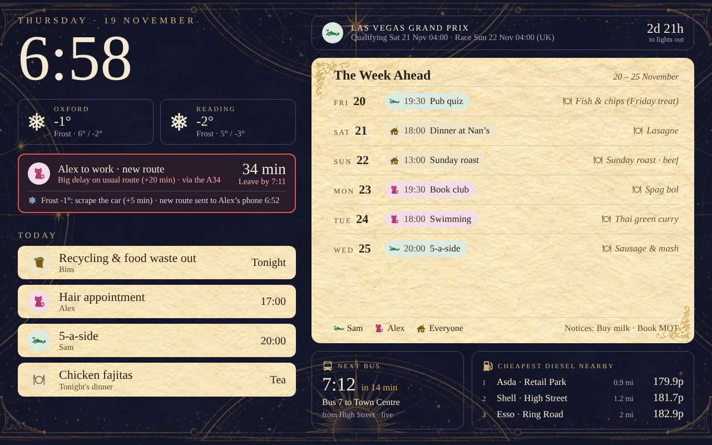

# Family Dashboard

A free, always-on kitchen board for an old iPad or Android tablet, set up for a family in Mississauga, Ontario. It shows what the household needs at a glance: calendars, birthdays, the commute, bins, gas prices, notes and dinners. No subscriptions, no home server.

Based on [stewie1308-ui/FamilyDashboard](https://github.com/stewie1308-ui/FamilyDashboard), with the UK-only parts replaced by Canadian ones.


| Morning with a route alert | Night mode |
|---|---|
|  |  |

## What it shows

- **Clock, date and weather** for up to two places, with frost warnings
- **Today and the week ahead** from Google Calendar, colour-coded per person
- **Birthdays and anniversaries** coming up, with ages ("turns 71")
- **Commute:** live drive time and a leave-by time (adds extra minutes when it's frosty)
- **Route alerts:** a push notification **only** when a crash or closure means a different route is quicker, with a one-tap Google Maps link. Morning and evening.
- **Bins:** "bins out tonight", worked out from your collection pattern, so it stays out of your calendars
- **Gas prices:** today's Mississauga average and tomorrow's predicted price from Gas Wizard, with "fill up today" or "wait" advice
- **Formula 1 countdown**
- **Dinners** from the family meal tracker, with a "haven't had it in a while" idea on unplanned nights
- **Notes** from a shared Todoist project, so everyone can add them from their phones
- **Night mode** (23:00–06:30): dimmed clock, moon phase, and a "bins / frost / tomorrow" line

Every section is optional. Anything you don't set up simply doesn't appear.

## How it works

```
iPad (Safari, Guided Access) or Android tablet (Fully Kiosk Browser)
   └─ board page (web/index.html, on GitHub Pages or Netlify)
         └─ every 2 min asks for JSON ─► Google Apps Script (your account, free)
                                            ├─ Google Calendar, Maps (traffic), Tasks
                                            ├─ Open-Meteo (weather), Jolpica (F1)
                                            ├─ Gas Wizard (gas prices), Todoist (notes)
                                            ├─ meal tracker on Supabase (dinners)
                                            └─ ntfy (push alerts)
```

Everything runs on free tiers. Your keys stay in your own Apps Script **Script properties**, never in this repo.

## Quick start (about 15 minutes for the basics)

1. **Copy the script:** create a new project at [script.google.com](https://script.google.com) and add the four files from [`apps-script/`](apps-script).
2. **Edit `Config.gs`:** names, colours, weather places, bin day. Leave anything you don't want empty.
3. **Run `setup`**, then **Deploy → New deployment → Web app** (Execute as: Me, Who has access: Anyone).
4. **Host the page:** see [docs/setup.md](docs/setup.md#4-host-the-board-page).
5. **Set up the tablet:** see [docs/tablet.md](docs/tablet.md).

The full walkthrough is in [docs/setup.md](docs/setup.md). Optional extras (route alerts, gas prices, birthdays, notes and dinners) are in [docs/modules.md](docs/modules.md).

## Make it yours

The look is a dark "enchanted library" theme: parchment panels, gold details and a starry night mode. You can change the colours, icons and artwork, with or without an AI image tool. See [docs/design.md](docs/design.md).

## Docs

- [Setup](docs/setup.md)
- [Tablet and kiosk](docs/tablet.md)
- [Optional modules](docs/modules.md)
- [Customising the design](docs/design.md)
- [Troubleshooting](docs/troubleshooting.md)

## Tested on

The original was tested on a Lenovo Tab M10 HD (Android 10) with Fully Kiosk Browser. This version adds support for older iPads (Safari on iOS 10.3 and newer, 4:3 layout); see [Old iPads](docs/modules.md#old-ipads).

## Licence

MIT. See [LICENSE](LICENSE).
