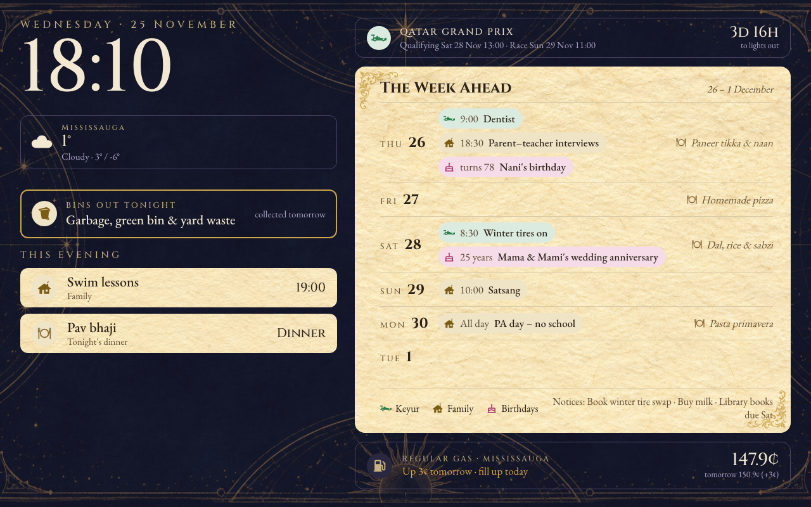
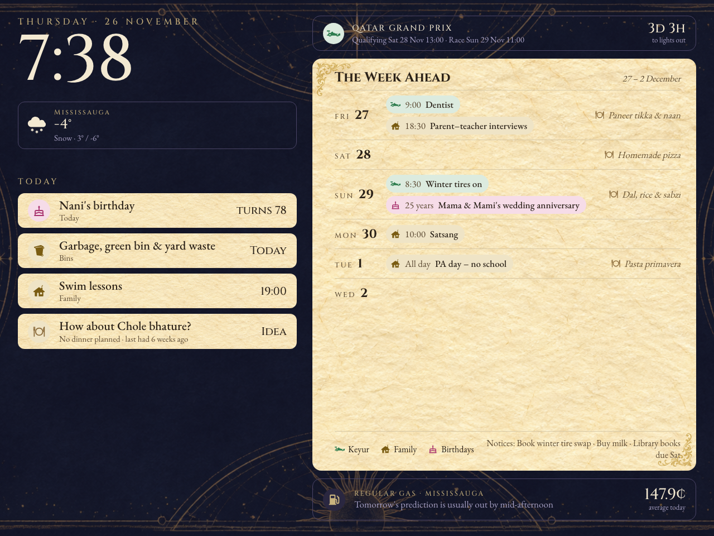
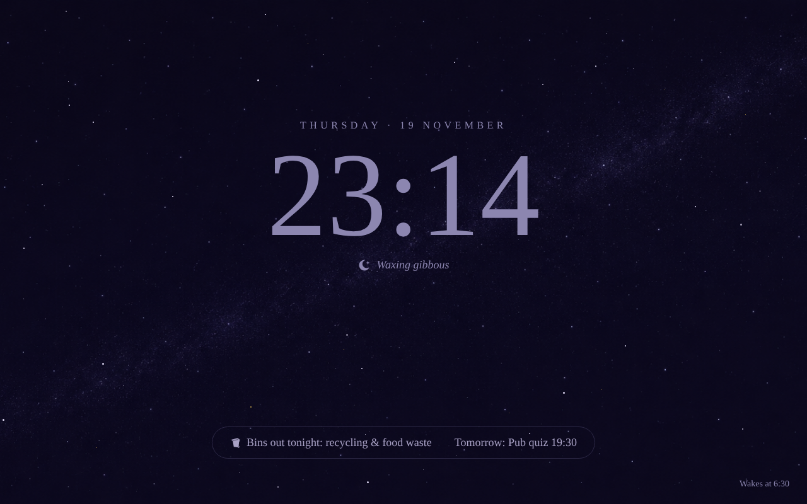
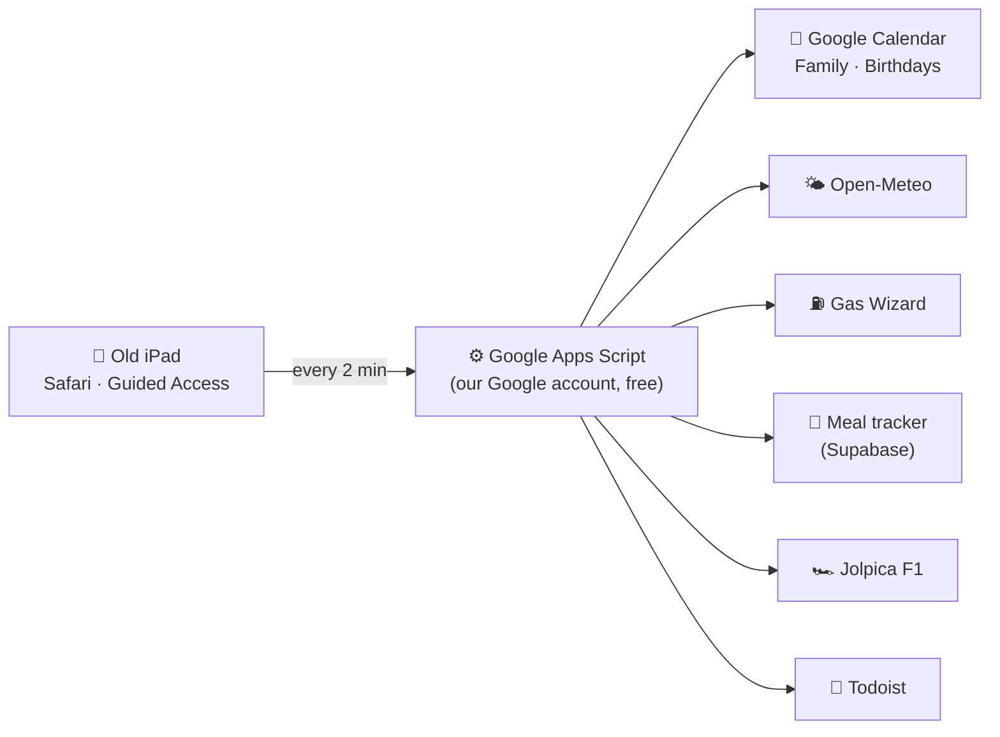

<div align="center">
  <h1>🏡 Family Dashboard</h1>
  <p><strong>An always-on kitchen board for a family in the GTA, running on an old iPad.</strong></p>
  <p>Calendars, birthdays, bins, gas prices, dinners and the F1 countdown, all in one place.<br>
  Free to run: no subscriptions, no home server, no app store.</p>
  <p>
    
    
    
    
  </p>
  <p><a href="https://keyurhindocha.github.io/FamilyDashboard/"><strong>Open the board →</strong></a> <sub>(asks for a board link; no data without one)</sub></p>
  
</div>

---

## ✨ What's on the board

| Section | What it shows |
|---|---|
| 🕰️ **Clock, date & weather** | Big serif clock, Mississauga weather, and a frost warning on cold mornings. |
| 📅 **Today & the week ahead** | Pulled from the shared **Family** calendar (and a parent's own), colour-coded per person. |
| 🎂 **Birthdays & anniversaries** | From the *Birthdays and Anniversaries* calendar, with ages worked out from the year: "Grandma's birthday · turns 78". |
| 🗑️ **Bins** | Thursday pickups: green bin weekly, garbage and recycling on alternating weeks, yard waste in season. "Bins out tonight" from 5pm the night before. |
| ⛽ **Gas prices** | Today's Mississauga average and **tomorrow's predicted price** from [Gas Wizard](https://gaswizard.ca), with plain advice: *"Up 3¢ tomorrow · fill up today"*. |
| 🍛 **Dinners** | From the family **meal tracker**. Nothing planned tonight? It suggests a favourite you haven't had in a while: *"How about chole bhature? Last had 6 weeks ago."* |
| 🏎️ **Formula 1** | Countdown to lights out, with qualifying and sprint times in Toronto time. |
| 📝 **Notes** | A shared Todoist list anyone can add to from their phone. |
| 🌙 **Night mode** | 23:00–06:30: a dim starry clock with tomorrow's essentials (bins, frost, first event, gas, birthdays). **Tap to peek** at the full board for a minute. |

Every section is optional. Anything that isn't set up simply doesn't appear.

## 📸 A day on the board

<table>
<tr>
<td width="50%"></td>
<td width="50%"></td>
</tr>
<tr>
<td><b>Thursday 7:38am, iPad (4:3).</b> A birthday, collection day, tonight's plans, and a dinner idea because nothing's planned yet.</td>
<td><b>Wednesday 11:30pm, night mode.</b> Bins out, frost by morning, gas going up, and whose birthday it is tomorrow.</td>
</tr>
</table>

## 🧱 How it works



- **The board** is a single HTML page ([`web/index.html`](web/index.html)) laid out at 1280×800, or 1280×960 on a 4:3 iPad, and scaled to fit the screen.
- **The data** comes from a small Google Apps Script ([`apps-script/`](apps-script)) that runs in our own Google account. It gathers every feed, caches it, and hands the board one JSON object. If one feed fails, the rest keep working.
- **Secrets** (Supabase key, Todoist token) live in Apps Script's **Script properties**, never in this repo.

## 🍎 Built for an old iPad

The tablet is a retired **iPad 4th generation (MD510C/A)**, stuck on **iOS 10.3.3** for good, that stays on in the kitchen all the time. So the page is careful about old Safari:

- Written for **Safari 10**: plain ES5 JavaScript, `XMLHttpRequest` instead of `fetch`, flexbox spacing replaced with margins, and a fallback to the iPad's own clock if time zones aren't supported.
- On 4:3 screens it **grows taller** instead of leaving black bars, and the week panel gets the extra room.
- Reloads itself at 4am every night to clear memory.

**Kiosk setup (iOS 10):** Settings → Display & Brightness → **Auto-Lock: Never**. Open the board in Safari → Share → **Add to Home Screen**. Then turn on Settings → General → Accessibility → **Guided Access** and triple-click the Home button to lock the board on screen. Full steps are in [docs/tablet.md](docs/tablet.md).

## 🚀 Setting it up

1. **Copy the script:** create a project at [script.google.com](https://script.google.com) and add the four files from [`apps-script/`](apps-script).
2. **Edit [`Config.gs`](apps-script/Config.gs):** people and colours, calendars, weather place, bin schedule, gas city and type. It's the only file you need to touch.
3. **Add secrets** in Project Settings → Script properties (only for the sections you want):

   | Property | For |
   |---|---|
   | `SUPABASE_URL`, `SUPABASE_SERVICE_KEY` | dinners from the meal tracker |
   | `TODOIST_TOKEN` | shared notes |
   | `NTFY_TOPIC`, `NTFY_TOKEN` | commute route alerts |

4. **Run `setup`**, then **Deploy → New deployment → Web app** (Execute as: *Me*, Who has access: *Anyone*).
5. **Open the board link** on the iPad. The repo is private, so use the Apps Script link directly or a private Netlify Drop copy ([setup step 4](docs/setup.md#4-host-the-board-page)).

Handy checks in the Apps Script editor: `testEverything`, `testCalendars`, `testBirthdays`, `testNotes`.

> **Changed the board page?** Edit `web/index.html`, then run `python3 tools/sync-apps-script-page.py` to update `apps-script/Index.html` to match.

## 🛠️ Configuration at a glance

```js
TIMEZONE: 'America/Toronto',
FAMILY_CALENDAR: 'Family',
BIRTHDAY_CALENDAR: 'Birthdays and Anniversaries',
PLACES: [{ name: 'Mississauga', lat: 43.5890, lon: -79.6441 }],

BIN_DAY: 4,                          // Thursday
BIN_CYCLE: ['Garbage', 'Recycling'], // alternate weeks
BIN_EVERY_WEEK: 'green bin',
BIN_SEASONAL: [{ label: 'yard waste', from: '2026-11-01', until: '2026-12-10' }],

GAS_CITY: 'mississauga',  GAS_TYPE: 'Regular',   // or 'Premium' / 'Diesel'
MEAL_SUGGEST: true,                  // "haven't had it in a while" ideas
```

Everything is explained in [docs/modules.md](docs/modules.md).

## 🗺️ Roadmap

- [x] Family & birthday calendars, Toronto time
- [x] Peel + Circular Materials bin schedule, with seasonal yard waste
- [x] Gas prices with tomorrow's prediction
- [x] Dinners and ideas from the meal tracker
- [x] Old-iPad support and 4:3 layout
- [ ] Kids' chore chart
- [ ] Photo slideshow from a Google Drive folder
- [ ] Own name and colour for each family member

## 📚 Docs

[Setup](docs/setup.md) · [Tablet & kiosk](docs/tablet.md) · [Modules](docs/modules.md) · [Design](docs/design.md) · [Troubleshooting](docs/troubleshooting.md)

## 🙏 Credits

Built on the lovely [stewie1308-ui/FamilyDashboard](https://github.com/stewie1308-ui/FamilyDashboard), including its "enchanted library" design and Higgsfield artwork. The UK-only parts (bus times, UK fuel prices) were swapped for Canadian ones.
Data from [Open-Meteo](https://open-meteo.com), [Gas Wizard](https://gaswizard.ca), [Jolpica F1](https://github.com/jolpica/jolpica-f1), Google Calendar and Todoist.

MIT licence. See [LICENSE](LICENSE).
